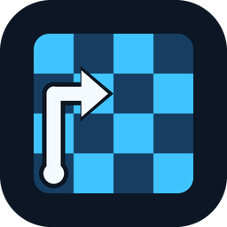

# Chess Lens

> [!IMPORTANT]
> To work you need to download the engine from https://github.com/LeelaChessZero/lc0/releases

> [!NOTE]
> **Run as administrator:** Don't be afraid to run the project with administrator rights - this is necessary for the program to correctly capture/scan the screen and interact with the chess engine.

> [!WARNING]
> Do not play ranked games with this app, as you may be banned for this. Use it for educational purposes only.

| Key | Action |
| :--- | :--- |
| `F8` | start/setup |
| `F2` | Search for chessboard |
| `right click` | Close the program |

# Running
1. Download the release version that suits you https://github.com/veshka33/chess-lens/releases,
2. Then download the engine from https://github.com/LeelaChessZero/lc0/releases.
3. Unpack the archive with the engine and rename it to **lc0**
4. You need to put everything in one folder and you can run it.
